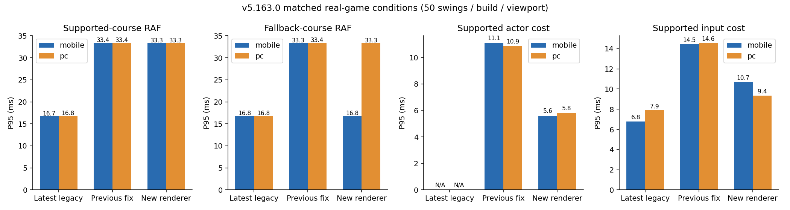
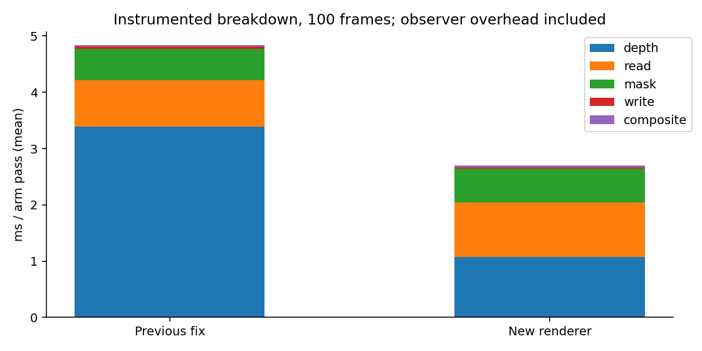
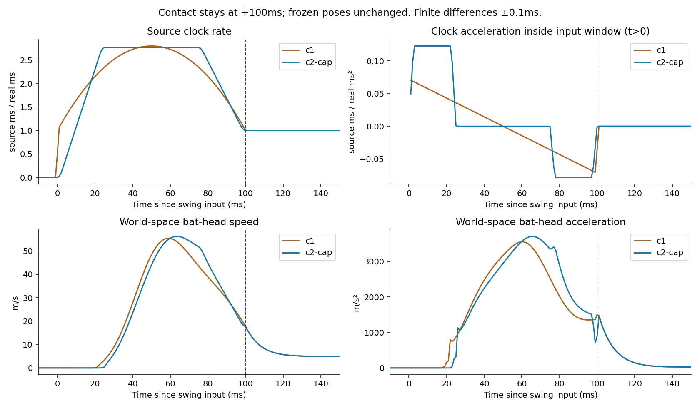
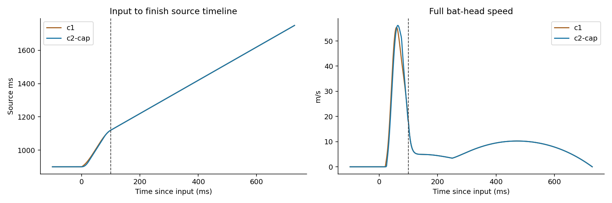
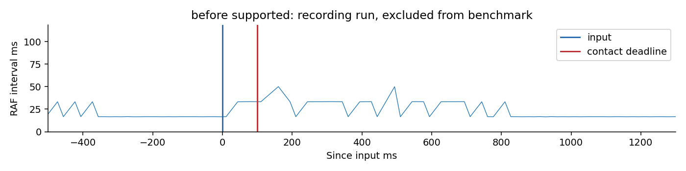
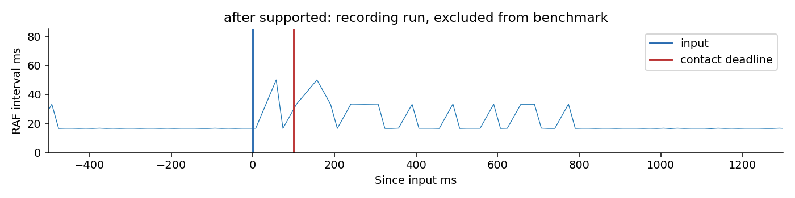
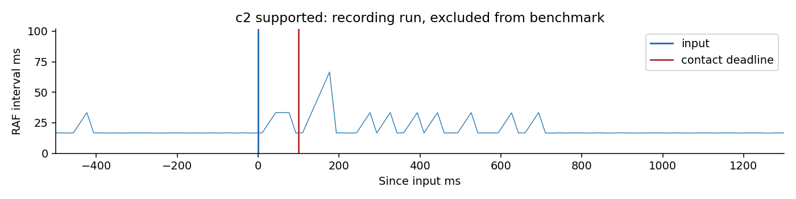

# 타격 렌더링·시간 매핑 추가 검증

**병합·GitHub Pages 배포 보류. 실제 iPhone Safari 미검증.**

기준은 최신 Claude v5.163.0 `c7352ba`다. 이전 보고서의 v5.160.25 결과를 이번 결과와 섞지 않았다. 기존 렌더러, 이전 최적화(`a8d0559`), 추가 최적화는 모두 같은 최신 게임 코드 위에서 비교했다. C2는 리뷰용 opt-in이며 기본 C1 시간을 자동 교체하지 않는다.

**결론: 렌더링 비용은 줄었지만, 새 모션 지원 코스의 RAF P95는 여전히 약 33.3ms다. 전체 표본의 P95 16.8ms에는 fallback이 섞여 있으므로 지원 코스의 60fps 달성으로 해석하면 안 된다. C2 후보는 가속도 절충이 나빠 기본값 채택을 보류한다.**

## 실제 게임 측정

Chromium, PC 1280×720 및 390×844 모바일 viewport, 동일 시드·타자·투수·직구·코스·입력 목표 시각. 기존/이전/중간/최종 렌더링 비교는 각 환경·구성당 50회(지원/외곽 fallback 각 25회)다. C2는 각 환경 12회의 탐색 측정이며 표본 크기가 달라 같은 신뢰도로 보지 않는다. 별도 안타는 환경·구성당 4회다. 녹화와 CDP 프로파일은 별도 실행하여 아래 주 측정에서 제외했다. 새 핸드폰 하드웨어 측정은 아니며 CPU 공유 환경이다.

| 환경 | 구성 | RAF 평균 / P95 / P99 ms | 관측 평균 FPS¹ | 입력 처리 P95 ms | actor P95 ms | >50ms / 1000프레임 |
|---|---|---|---:|---:|---:|---:|
| mobile | 최신 기존 렌더러 | 16.68 / 16.80 / 16.80 | 60.0 | 6.86 | — | 0.00 |
| mobile | 이전 최적화 | 19.97 / 33.40 / 33.40 | 50.1 | 14.26 | 10.90 | 1.02 |
| mobile | 벡터·기저 재사용 중간안 (C1) | 17.60 / 33.30 / 33.40 | 56.8 | 8.52 | 5.50 | 0.00 |
| mobile | 재사용 + 합성 영역 축소 (C1) | 17.35 / 16.80 / 33.40 | 57.6 | 8.47 | 5.50 | 0.00 |
| mobile | 추가 최적화 + C2 | 17.66 / 33.30 / 33.40 | 56.6 | 8.78 | 5.85 | 0.53 |
| pc | 최신 기존 렌더러 | 16.83 / 16.80 / 16.80 | 59.4 | 7.22 | — | 0.00 |
| pc | 이전 최적화 | 20.38 / 33.40 / 33.40 | 49.1 | 14.27 | 10.80 | 2.25 |
| pc | 벡터·기저 재사용 중간안 (C1) | 18.55 / 33.30 / 33.40 | 53.9 | 9.40 | 6.00 | 0.41 |
| pc | 재사용 + 합성 영역 축소 (C1) | 18.29 / 33.30 / 33.40 | 54.7 | 8.79 | 5.80 | 0.94 |
| pc | 추가 최적화 + C2 | 18.38 / 33.30 / 33.40 | 54.4 | 8.24 | 6.00 | 1.67 |

기존 렌더러에는 승인 actor 래퍼가 없어 actor 비용은 —로 표시했다. 기존 렌더러가 무료라는 뜻은 아니다.

¹ 1000/평균 RAF 간격으로 계산한 관측 수치. 디스플레이 FPS나 실제 iPhone 성능을 뜻하지 않는다. P95/P99 및 모든 간격은 `summary.csv`와 raw JSON에 있다. 33.3ms/50ms 임계값은 반올림 양자화(33.4/50.1ms)의 영향을 받는다.



최종 모바일에는 >50ms 간격이 없었지만 PC에는 7개가 남았다. PC 최대 116.7ms는 fallback HR에서 입력 약 +1180ms, 필드 전환 약 109ms 전의 118ms long task와 겹쳤다. 해당 구간 mvPaint 최대는 2.6ms여서 actor 함수 비용만으로 설명할 수 없다. GC·다른 동기 작업·시스템 지연 중 원인은 확정하지 않았다. `longframes.json`에 시간 위치와 동반 비용을 남겼다.

## 무엇을 최적화했나

- 3D 3성분 벡터의 map/reduce 콜백을 같은 연산 순서의 스칼라 식으로 바꿔 불필요한 콜백 할당을 줄였다. 승인 파일 수정 없이 번들 생성 과정에서만 적용한다.
- 몸통의 같은 높이/체형 기저와 같은 각도 표면점을 R 단위 WeakMap에 저장한다. 소프트웨어 깊이 검사와 셔츠 UV가 같은 숫자를 재사용한다. 해상도, 삼각형 수, depth 판정, 팔 가림, 유니폼 텍스처, Canvas 그리기 순서는 유지한다.
- 머리 깊이 메시가 정확히 같은 머리 위치·시선·스탠스 기저일 때만 재사용한다. actor factory당 4개 제한, 숫자 키 일치만 허용한다.
- 앞선 작업의 ROI readback·버퍼 재사용을 유지했다. 이번 추가 작업으로 readback 픽셀 수를 더 줄였다고 주장하지 않는다. 마지막 합성은 같은 이미지의 ROI만 동일 좌표에 그려 투명 여백의 합성을 줄였다.

독립 180프레임 CDP 샘플(벡터·기저 재사용 중간안)에서 actor 평균은 약 12.19→5.90ms였다. 이 값은 짧은 분리 프로파일이며 실제 게임 결과 표와 구분한다. 샘플링 프로파일의 GC 비용도 감소했으나 모든 프레임 드롭을 GC 탓으로 단정하지 않는다. 세부 비용 측정에는 관측 오버헤드가 포함된다.



| 분리 actor 프로파일 | actor 평균 ms | arm depth 평균 ms | readback 평균 ms | mask loop 평균 ms | put 평균 ms | drawImage 평균 ms |
|---|---:|---:|---:|---:|---:|---:|
| before | 10.888 | 3.394 | 0.820 | 0.560 | 0.038 | 0.022 |
| after | 5.607 | 1.079 | 0.966 | 0.604 | 0.020 | 0.033 |

arm 통계는 actor 전체 비용이 아니다. 셔츠 UV·신발·머리 그리기, geometry 생성, 나머지 필드/UI, 이벤트 루프 지연은 별도로 남는다. CDP 원시 `profile-*.json`, 비용 원시 `stages.json`을 포함한다.

## 시간 매핑: 개선 폭과 한계

입력 전에는 source 900(PLANT)을 넘지 않는다. PLANT에서 이미 대기 중인 실제 입력에서는 source 시작 속도는 0이다. 처음 검토한 시작 속도 1 / 최대 2.6배의 국소 후보는 이 대기 경계를 반영하지 않아 최종 비교에 사용하지 않았다. 입력 후 판정 기한 +100ms에 source 1120(CONTACT), +730ms에 source 1750(FINISH)를 유지한다. pose·판정좌표·공 물리·결과 계산은 바꾸지 않았다.

C2 후보는 실제 PLANT 대기의 source 속도 0에서 출발한다. 가속도가 0에서 시작/끝나는 짧은 선형 램프를 두고, 재생 속도 plateau와 대칭 감속 구간을 적분한다. 원본 포즈에 새 보간을 더하지 않고 source clock만 바꾼다.

| 지표 (정상 PLANT 이후 입력) | 기존 C1 | C2 후보 |
|---|---:|---:|
| 최대 source 배속 | 2.80000 | 2.76667 |
| 최대 source clock 가속도 (source ms / real ms²) | 0.07056 | 0.12296 |
| 최대 배트 헤드 속도 (0<입력 후<100ms, m/s) | 55.40256 | 56.18358 |
| 최대 양손 그립 속도 (0<입력 후<100ms, m/s) | 8.19026 | 8.21915 |
| 최대 배트 헤드 가속도 (0<입력 후<100ms, m/s²) | 3551.77994 | 3702.61606 |

| 실제 입력 표본의 clock 최고 배속 (조기 헛스윙 포함) | C1 최종 렌더러 | C2 후보 |
|---|---:|---:|
| mobile | 7.469 | 6.559 |
| pc | 7.382 | 6.365 |





이 C2 후보는 채택을 권하지 않는다. 입력 시작/CONTACT의 clock 경계는 매끄러워졌지만, 정상 입력 최대 배속 감소는 약 1.2%에 그치고 구간 내부 clock 가속도 및 배트 헤드 최대 가속도가 커졌다. C2라는 이름이 전체 문제 해결을 뜻하지 않는다. 이 제약에서는 원본 220ms를 실제 100ms 안에 재생하므로 평균 2.2배속이 필요하다. 입력 전 스윙·판정 지연·승인 동작 생략 없이 1배속으로 바꾸는 것은 불가능하다. READY/PLANT 사전 준비는 이미 투구 진행 중 이루어지고 있다.

임팩트 직후 원본 EXTENSION의 급감속은 유지된다. C2 후보는 입력 시작 및 CONTACT에서 clock의 가속도를 연속으로 만들지만, 원본 동작 자체의 가속도와 합성한 세계 좌표 속도는 여전히 크게 감소한다. 그러므로 타격 감속 문제가 완전히 해결됐다고 보고하지 않는다. 입력이 PLANT보다 이른 경우에는 남은 source 길이가 더 길어 배속이 더 커질 수 있다.

기본 매핑은 C1로 유지하고 C2는 `m._approvedClockMode="c2-cap"`인 검수에서만 사용한다. 실제 채택은 정상속도 비교 검수 후 결정한다.

## 지원 / fallback / 타격 결과

| 환경·구성 | 지원: RAF P95 / 입력 P95 | fallback: RAF P95 / 입력 P95 | guard-not-ready | 결과 집계 |
|---|---|---|---:|---|
| mobile latest-baseline | 16.70 / 6.80 | 16.80 / 6.62 | 0 | {'HR': 26, 'foul': 12, 'whiff': 12} |
| mobile latest-before | 33.40 / 14.46 | 33.30 / 4.60 | 0 | {'HR': 26, 'foul': 12, 'whiff': 12} |
| mobile latest-final | 33.30 / 10.70 | 16.80 / 3.88 | 0 | {'HR': 26, 'foul': 12, 'whiff': 12} |
| mobile latest-c2 | 33.30 / 9.50 | 16.80 / 3.23 | 0 | {'HR': 6, 'foul': 4, 'whiff': 2} |
| pc latest-baseline | 16.80 / 7.90 | 16.80 / 6.98 | 0 | {'HR': 26, 'foul': 12, 'whiff': 12} |
| pc latest-before | 33.40 / 14.58 | 33.40 / 4.34 | 1 | {'HR': 26, 'foul': 12, 'whiff': 12} |
| pc latest-final | 33.30 / 9.36 | 33.30 / 4.44 | 0 | {'HR': 26, 'foul': 12, 'whiff': 12} |
| pc latest-c2 | 33.40 / 8.28 | 33.30 / 4.03 | 0 | {'HR': 6, 'foul': 4, 'whiff': 2} |

주 50회 fixture의 fair contact가 HR로 결정되는 조건이라, wind=0의 별도 안타 4회×3구성×2viewport도 수행했다. 이 결과는 `hits-*.json`으로 분리하며 주 표본에 섞지 않았다. 결과를 강제로 만드는 판정 함수 stub은 사용하지 않았다. 같은 목표 입력 시각이더라도 실제 브라우저 전달 지터는 있으며 raw 데이터에서 노출한다.

## 보존 검증

- 승인 원본 5개는 `86369a5` 대비 바이트/SHA256 동일. 351 world 표본 최대 차이 0. 캔버스 44개 시간 표본에서 변경 채널 0, arm visibility 통계 동일.
- 판정·물리·저장·기록·리그·성장·기존 캐릭터 함수는 최신 `c7352ba`와 함수 본문 대조. `isolation.json` 확인.
- 3×3 코스의 지원 범위 및 외곽 fallback, 좌타 기존 모션, 3개 viewport 경계, 실제 1타석 기록과 save/load는 `checks.json`·`geometry.json`·`bounds.json`·`result-flow.json`에 기록.
- `input-clock.json`: 입력 전 source≤900 및 미스윙, 정확한 +100ms CONTACT / +730ms FINISH 검증.
- 이전에 알려진 growtest의 구원투수 두 번째 로테이션 기대값 실패는 이번 범위에서 수정하지 않았다.

## 실제 게임 정상속도 영상 (390×844)

영상에 실시간 RAF 간격 HUD를 표시했다. 시작 대기 0.5초만 제거했고 재생 속도는 변경하지 않았다. 녹화는 별도 실행이며 성능 표에 섞지 않았다. 인코딩 FPS는 성능 검증 근거가 아니다. 각 클립별 실제 RAF 자료도 `video/metadata.json` 및 아래 그림으로 제공한다.

- [before 지원 코스](video/before-supported.mp4) · [before fallback](video/before-fallback.mp4)


- [after 지원 코스](video/after-supported.mp4) · [after fallback](video/after-fallback.mp4)


- [c2 지원 코스](video/c2-supported.mp4) · [c2 fallback](video/c2-fallback.mp4)


## 남은 승인 사항

성능 개선 결과와 C2 정상속도 비교는 사용자 검수가 필요하다. 실제 iPhone Safari는 이 Linux/Chromium 환경에 기기·WebKit 연결이 없어 미검증이다. 승인 모션 자체의 post-contact 감속을 바꾸려면 별도 범위 승인과 원본 변경 검수가 필요하다. `claude/next` 병합 및 GitHub Pages 배포는 수행하지 않았다.

## 재현 정보

```sh
BASELINE_REF=c7352ba BEFORE_REF=a8d0559 OUTPUT_DIR=gpt-review/batting-render-clock/data MODE=after SIZE=mobile node gpt-review/batting-performance/measure.cjs
CLOCK_MODE=c2-cap OUTPUT_DIR=gpt-review/batting-render-clock/data MODE=after SIZE=mobile TAG=latest-c2 node gpt-review/batting-performance/measure.cjs
node gpt-review/batting-render-clock/preservation.cjs
node gpt-review/batting-render-clock/clocks.cjs
```

보존한 정식/탐색 비교 데이터는 448타격(기존/이전/중간/최종 렌더러 400 + C2 24 + 별도 안타 24)이다. 별도의 10회 버퍼 탐색은 개선이 없어 폐기했고 `probe-buffer-mobile.json`에 남겼다. 초기 모바일 이전안 재측정으로 교체된 파일·warmup은 이 횟수에 포함하지 않는다. 각 raw JSON의 `productSHA256`이 정확한 index.html 빌드를 식별한다. HTML SHA 및 브라우저 버전은 source-manifest.json에 정리한다.
