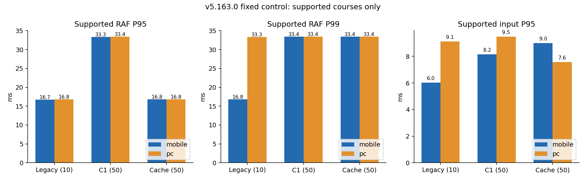
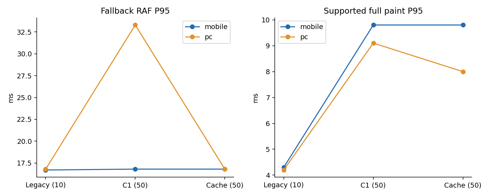
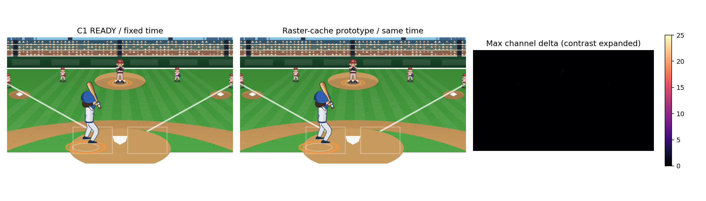

# 타격 렌더링 구조 시제품 검증

**병합·Pages 배포 안 함. C1 유지, C2 미채택. 실제 iPhone Safari 미검증.**

기술적 결론: 정적 구장 재사용으로 supported 성능을 회수할 가능성은 확인했다. 실제 표시 크기 고정포즈6쌍은 동일했지만, 강제 Canvas readback 일부 RGB 차이와 최신 v5.166.0 PC 단기측정의 33.3ms가 남아 기본값으로 채택하지 않았다. 새 캐시는 명시적으로 켠 검수 모드에서만 사용하고 기존 C1을 유지한다.

## 비교 기준

- 주 비교는 v5.163.0 `c7352ba`/최적화 C1 `1318051`을 고정했다. 새 시각 번들과 배경 호출 한 곳만 이식한 통제 HTML로 비교했다. 게임 판정·통계·팀 데이터는 같은 v5.163.0이다.
- 기존 모션 10회, 현재 C1 50회, 캐시 50회 × 모바일390×844/PC1280×720. 매번 supported/fallback을 반씩 나눴다. 동일 시드·직구·타자·투수·코스·입력 목표 시각이며 실제 브라우저 전달 지터도 저장했다.
- 작업 브랜치는 최신 Claude v5.166.0 `18b1ea6` 위에 별도 구성했다. 최신 코드의 10회×2viewport smoke 측정과 엔진/저장 검사는 주 v5.163.0 표와 구분한다.
- 녹화·픽셀 검사·프로파일을 주 성능 측정과 동시에 실행하지 않았다. 글꼴/변환 보존이 미흡했던 1차 시제품 자료는 data/rejected-v1에 따로 보관하고 아래 표에서 제외했다. 원시 데이터는 productSHA256과 Chromium 버전을 기록한다. 공유 Linux 호스트의 viewport 측정이며 실제 휴대폰 CPU/GPU 결과가 아니다.

## 프레임 결과

| 환경/코스 | 구성·표본 | 평균 간격 ms / 관측FPS¹ | RAF P95 / P99 / 최대 ms | >33.3 / >50ms 프레임 | 입력 P95 / P99 ms |
|---|---|---|---|---|---|
| mobile/supported | 기존 · 5회 | 16.77 / 59.6 | 16.70 / 16.80 / 33.40 | 1 / 0 (총 815) | 6.02 / 6.16 |
| mobile/supported | 최적화 C1 · 25회 | 18.05 / 55.4 | 33.30 / 33.40 / 66.70 | 227 / 1 (총 3764) | 8.16 / 8.28 |
| mobile/supported | 구장 캐시 · 25회 | 17.11 / 58.5 | 16.80 / 33.40 / 66.70 | 72 / 1 (총 3968) | 9.00 / 9.53 |
| mobile/fallback | 기존 · 5회 | 16.73 / 59.8 | 16.70 / 16.80 / 33.40 | 2 / 0 (총 819) | 6.56 / 6.59 |
| mobile/fallback | 최적화 C1 · 25회 | 17.28 / 57.9 | 16.80 / 33.40 / 50.10 | 103 / 2 (총 3924) | 3.64 / 4.16 |
| mobile/fallback | 구장 캐시 · 25회 | 16.89 / 59.2 | 16.80 / 33.30 / 66.60 | 40 / 2 (총 4025) | 3.28 / 4.21 |
| pc/supported | 기존 · 5회 | 16.87 / 59.3 | 16.80 / 33.30 / 33.40 | 5 / 0 (총 806) | 9.12 / 9.18 |
| pc/supported | 최적화 C1 · 25회 | 18.89 / 52.9 | 33.40 / 33.40 / 50.10 | 349 / 3 (총 3589) | 9.48 / 9.88 |
| pc/supported | 구장 캐시 · 25회 | 17.17 / 58.2 | 16.80 / 33.40 / 50.00 | 80 / 0 (총 3938) | 7.58 / 7.75 |
| pc/fallback | 기존 · 5회 | 16.87 / 59.3 | 16.80 / 33.30 / 33.40 | 5 / 0 (총 808) | 6.94 / 6.99 |
| pc/fallback | 최적화 C1 · 25회 | 17.59 / 56.8 | 33.30 / 33.40 / 50.00 | 153 / 0 (총 3847) | 4.92 / 5.61 |
| pc/fallback | 구장 캐시 · 25회 | 16.85 / 59.3 | 16.80 / 33.29 / 50.00 | 33 / 0 (총 4010) | 4.40 / 7.64 |

¹ 1000/평균 RAF 간격으로 계산한 관측 수치다. 인코딩 FPS나 물리적 디스플레이 성능을 뜻하지 않는다. 33.3ms 임계값에는 33.4ms 양자화가 포함된다. 다른 표본 수의 기존 모션은 참고용이고 C1/캐시 주 비교는 환경당 50회다.





## 최신 v5.166.0 별도 단기 측정

아래는 환경당10회(코스당5회)의 짧은 호환성/부하 확인이다. v5.163.0 50회 비교와 혼합하지 않는다. 특히 최신 PC supported P95에 33.3ms가 남아 최신 서비스 성능을 해결했다고 볼 수 없다.

| 환경/코스 | RAF P95/P99 ms | 입력 P95/P99 ms |
|---|---|---|
| mobile/supported | 16.80/33.30 | 19.80/22.36 |
| mobile/fallback | 16.70/16.80 | 3.38/3.40 |
| pc/supported | 33.30/33.40 | 7.98/8.08 |
| pc/fallback | 33.30/33.40 | 7.24/7.77 |

## 구현한 구조

기존 타자의 자세를 건너뛰거나 배트·팔 레이어를 단순화하지 않았다. 매번 반복하던 `mvSky → mvCity → mvLights → mvBoard → mvStand → mvField` 6개 정적 구장 패스를 화면 크기의 별도 Canvas로 보관한다. 타자·투수·야수·주자·공·기록은 실시간 경로 그대로다.

첫 화면은 기존 underlay를 복사한 뒤 같은 Canvas 상태와 원래 카메라 변환 명령 순서로 구장만 렌더링한다. 분리 Canvas에는 원본의 유효 언어도 전달해 텍스트 glyph 선택을 맞춘다. 재사용 때 1:1 `copy` 합성하고 후속 Canvas 상태를 복원한다. 단순 투명 레이어의 source-over 방식은 1LSB 차이가 있어 사용하지 않았다.

키: 네이티브 canvas 크기·변환행렬·Canvas 스타일/폰트 상태, 구장/디테일 데이터, 홈·원정 응원석 정의, 날씨·포스트시즌, 폰트 loadingdone 세대. 기본값은 캐시 OFF이며 검수에서만 m._approvedStructureMode를 on으로 설정한다. 몸통·팔·유니폼은 캐시 대상이 아니므로 선수 얼굴/배번 변경만으로 정적 구장을 다시 만들 필요는 없다.

## 캐시 비용

| 환경 | 주 측정 적중/미스 | 적중률² | 회말 관측 상주 RGBA MiB | 준비 포함 생성 P95 / 최대 ms | 측정 타석 중 생성 P95 ms |
|---|---|---:|---:|---|---|
| mobile | 4116 / 0 | 100.00% | 4.12 | 4.14 / 6.50 | 생성 없음 |
| pc | 4080 / 12 | 99.71% | 4.45 | 4.72 / 6.10 | 5.55 |

² eligible hit/(hit+miss); 기존 모션 bypass는 분모에서 제외한다. 첫 준비의 생성 비용을 없다고 처리하지 않았으며 bootMs와 전체 build history를 별도 보관했다.

RGBA 합계 상한은 12MiB다. 키가 바뀌면 backing canvas를 비우고 참조를 제거한다. 분리된 화면의 퇴출은 다음 eligible paint 때 수행한다. 이후 게임 화면을 다시 그리지 않으면 그때까지 해당 항목과 화면 참조가 유지되는 지연 정리 한계가 있어, 실제 배포 전 수명 관리 보강이 필요하다. 브라우저의 내부 GPU backing store·compositor·캐시 메타데이터까지 포함한 프로세스 RSS 상한은 아니다. 실제 iPhone 메모리는 미검증이다.

## 다른 구조가 이번에 부적합한 이유

| 후보 | 코드/측정에 따른 판단 |
|---|---|
| 정확한 전신 포즈 메모 | source time과 코스·look·유니폼·카메라가 키다. 움직이는 구간의 시간값이 거의 매번 달라 정확한 재사용 기회가 작다. 아래 실제 표본 참조. |
| 고정 간격 스프라이트 사전 생성 | 1750ms를 source60Hz로만 저장해도 106장. 풀 모바일 캔버스만 약436.7MiB/코스·외형이며 crop으로 줄일 수 있으나 source-grid 양자화는 현행 연속 포즈와 동일하지 않다. 실제 RAF·입력 시각을 모르는 상태에서 정확한 모든 포즈를 미리 생성할 수 없다. |
| 머리/몸통 depth 마스크 | 기존 head mesh·몸통 basis는 이미 재사용한다. 깊이 래스터는 움직이는 몸통 yaw·위치, 픽셀 격자, 팔간 가림의 최종 순서까지 맞아야 한다. 부분 캐시 추가는 가능성이 있으나 앞선 C1 분리 프로파일의 depth 전체 비용 약1ms 수준의 상한에 비해 검증 부담이 있다. 이번에는 변경하지 않았다. |
| WebGL/WebGPU 마스크 | 글꼴·셔츠UV·Canvas 경계, Float32 depth 및 현재 epsilon/팔 순서를 보존하는 별도 렌더러가 필요하다. 이 환경의 GPU 정보는 features.json에 기록했다. 소프트웨어/가상 GPU 결과를 실제 iPhone 성능으로 주장할 수 없어 새 GPU 엔진은 구현하지 않았다. |
| Worker/OffscreenCanvas actor | 전역 게임·폰트·Canvas 함수 의존성을 분리하고 프레임 번호/오래된 결과 폐기를 처리해야 한다. 입력→CONTACT100ms와 worker 지연의 동기화 검증이 추가로 필요해 최소 변경 범위를 넘는다. |

| 환경 | moving actor 표본 | 동일한 moving source time 반복 | 전체 pose 반복(READY/대기 포함) |
|---|---:|---:|---:|
| mobile | 1037 | 0 | 5 |
| pc | 996 | 0 | 4 |

정확한 source-time 반복률은 full image 동일성을 직접 판정한 hit rate가 아니다. 다른 시간의 그림을 같다고 간주하려면 허용 오차 또는 추가 비교 비용이 필요하다.

## 보존 검사와 실제 게임

- 명령 검사 9/9 통과. 최신 `18b1ea6`의 판정·공 물리·기록·저장/로드·리그·성장 함수 대조 포함.
- 승인 5개 원본 SHA/바이트 동일. world 351표본 최대 오차 0. 기존 actor Canvas 44표본 변경 채널0.
- 전체 경기 Canvas13개 포즈 및 구장·날씨·3viewport 조합 45개 추가 비교를 수행했다. 전체 화면 RGB 차이는 다음 줄에 따로 표시한다. 폰트 invalidation·선수/주자 독립성·메모리 pressure·분리된 화면 퇴출 검사는 통과했다.
- 전체 화면 픽셀 완전 일치는 35/45. 변경 채널 최대 543, RGB 차이 최대 31/255. 알파 변화는 0이며, 이 RGB 차이를 0이라고 처리하지 않았다.
- C1 time/start/remaining 함수는 기준과 동일. 임팩트 판정100ms, 공 물리, 타구 결과, 주루/수비 전환을 변경하지 않았다. C2를 다시 조정하지 않았다.
- 실제 1타석 기록 반영·결과 일회 소비·save/load, 좌타 기존 경로,3×3코스 및3viewport 경계 검사를 통과했다. 결과 JSON과 checks.json을 함께 제공한다.

| 환경·구성 | 결과 집계 | guard-not-ready |
|---|---|---:|
| mobile c1-control | {'HR': 26, 'foul': 12, 'whiff': 12} | 0 |
| mobile stadium-cache | {'HR': 26, 'foul': 12, 'whiff': 12} | 0 |
| mobile latest-smoke | {'HR': 6, 'foul': 2, 'whiff': 2} | 0 |
| mobile hits-c1 | {'3B': 4} | 0 |
| mobile hits-cache | {'3B': 4} | 0 |
| pc c1-control | {'HR': 26, 'foul': 12, 'whiff': 12} | 0 |
| pc stadium-cache | {'HR': 26, 'foul': 12, 'whiff': 12} | 0 |
| pc latest-smoke | {'HR': 6, 'foul': 2, 'whiff': 2} | 0 |
| pc hits-c1 | {'3B': 4} | 0 |
| pc hits-cache | {'3B': 4} | 0 |

기본 fair-contact fixture가 HR로 끝나는 조건은 앞선 보고서와 같다. 헛스윙·파울·HR은 위 표로 확인하고, 일반 안타는 별도 4회×2구성×2viewport 조건으로 검증해 data/hits-*.json에 보관했다. 영상 fixture와 실제1타석 기록/save 검사도 별도로 수행했다. 판정 결과 함수를 stub하지 않았다.

## 실제 표시 크기의 별도 비교

Canvas getImageData가 렌더링 백엔드에 영향을 줄 가능성을 분리하기 위해, 서로 다른 새 페이지에서 같은 고정 포즈를 브라우저 compositor screenshot으로도 캡처했다. 애니메이션·idleT만 고정한 비교이며 실제 플레이 성능 측정과 별도다. READY/CONTACT/FINISH × 모바일/PC 6쌍 모두 변경 채널0이었다. 결과는 screens/comparison.json에 있다. 강제 readback 검사의 RGB 차이는 화면이 항상 다르다는 뜻으로 단정하지 않는다. readback 자체의 백엔드 영향 가능성은 있으나 원인을 완전히 확정한 것은 아니다.

## 모바일 정상속도 영상

390×844, C1 그대로, 영상에 실시간 RAF HUD 표시. 25fps 인코딩 자체로60fps 판정하지 않고 JSON측정을 우선한다. 녹화는 독립 실행이며 시작 대기0.5초만 제거했다.

- [C1 supported](video/before-supported.mp4) / [캐시 supported](video/after-supported.mp4)
- [C1 fallback](video/before-fallback.mp4) / [캐시 fallback](video/after-fallback.mp4)



차이 그림은 RGB 차이를 눈으로 확인할 수 있게 색 범위를 확대했다. 실제 게임을 이 색으로 표시하는 것이 아니다.

## 100ms/220ms 제약: 이번에는 대안만

| 대안 | 필요한 제약 변경·영향 |
|---|---|
| 입력 판정창을 늘리기 | 220ms에 가깝게 하면 모션 압축은 줄지만 버튼 반응/공의 접촉 시각/기존 타이밍 난이도·밸런스가 바뀐다. 별도 게임설계 승인 필요. |
| 입력 전 스윙 진입 | 투구 보고 반응하는 게임에서 사용자가 스윙을 확정하기 전에 배트가 나가는 오류가 된다. 권하지 않는다. READY/PLANT 사전 준비는 이미 사용 중이다. |
| 승인 pre-contact 길이 줄이기 | 판정100ms는 유지할 수 있으나 승인220ms 동작의 타이밍을 재제작하는 것이므로 원본 변경·시각 재검수가 필요하다. |
| 물리시간/표시시간 지연 분리 | 입력 판정은100ms, 화면 접촉은 늦게 보이게 하면 공과 배트의 실제 시간 불일치·추가 표시 지연을 만들 수 있다. 단순 최적화가 아니며 별도 설계가 필요하다. |

이번에는 어느 대안도 적용하지 않았다.

## 채택 판단

시제품의 성능 실익은 확인했지만 강제 readback 전 범위의 RGB 비트 동일성, 최신 코드의 반복 성능, 실제 iPhone 검증은 미완료다. 자동 채택하지 않고 기본값은 현재 C1로 유지한다. 미세 합성 차이의 수용 여부도 사용자 검수가 필요하다. 새 모션의 정식 통합/배포는 동결하고 기존 서비스를 유지한다.

원본 포즈·타이밍을 다시 바꾸거나 기존 서비스 파일을 되돌리는 작업은 하지 않았다. 서비스에는 이 브랜치가 배포된 적이 없으므로 동결을 위해 실제 사이트를 수정할 필요도 없다.

## 재현

```sh
MODE=before COUNT=50 SIZE=mobile TAG=c1-control node gpt-review/batting-structure/measure.cjs
MODE=after COUNT=50 SIZE=mobile TAG=stadium-cache node gpt-review/batting-structure/measure.cjs
MODE=after LATEST=1 COUNT=10 SIZE=mobile TAG=latest-smoke node gpt-review/batting-structure/measure.cjs
node gpt-review/batting-structure/invalidation.cjs
node gpt-review/batting-structure/verify.cjs
```
