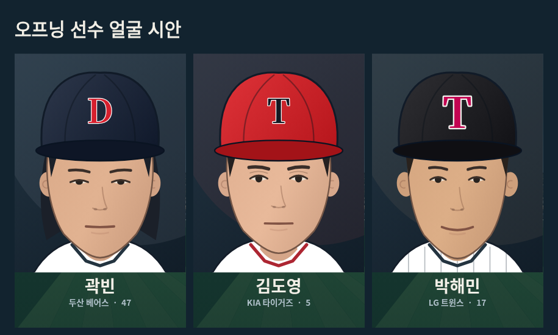

# 오프닝 1차 시안 — 곽빈 / 김도영 / 박해민

**별도브랜치 visual/opening-presentation. 게임버전 변경·병합·배포 안 함.** 기준은 최신확인 Claude d738712. 이번 결과는 게임시작 오프닝의 첫시안이며 국가연주/경기소개·결과팝업·주루/수비·실경기홈런추적은 후속범위다.

## 바로 보기

- [수정 오프닝 정상속도](video/after-mobile.mp4)
- [기존 오프닝 정상속도](video/before-mobile.mp4)
- [기존/수정 비교](comparison.png)
- [선수 얼굴 확대](faces.png)

영상은 실제브라우저의 오프닝재생을 녹화했다. 검토MP4는 무음이며 게임의 기존주제가는 그대로다. 25fps 인코딩은 실제60fps 측정/보증이 아니다.

## 바꾼 내용

- 일반캐릭터 대신 곽빈(두산47,우투)·김도영(KIA5,우타)·박해민(LG17,주자) 구성. 클럽기본유니폼을 읽고 오프닝 안에서만사용. LG 모자/헬멧은 프로필의T로 표현한다. 전역구단로고/유니폼표는 수정하지 않았다.
- KBO공식프로필과사진을 참고해 턱·눈/눈썹·코·입·피부·머리 특징을 직접그린 오프닝초상화. 사진/SVGpath자동트레이싱/공식사진다운로드호출을 게임에 넣지 않았다. 프로필번호는 실제이름을 확인했다(곽빈68220,김도영52605,박해민62415). 참고원본은 /tmp에만있고 제품/검토브랜치에 사진파일을 복사하지 않는다.
- 선수복제라인업 대신 초상화소개→곽빈투구→김도영승인스윙→박해민진입/다이브/베이스터치→박해민클로즈업→단독피니시타이틀. 전체8.85초 후 정지.
- 투구는 기존투구골격을 읽어 오프닝타이밍만 연속곡선으로 연결. 볼은 손에서 출발해 카메라쪽으로 접근하며 컷끝까지화면안에둔다. 실경기투수모션/판정은변경안함.
- 타격은 v5.171의 ApprovedBattingFactory를 새로설계하지않고 별도인스턴스로 재사용. 김도영외형/유니폼을 적용해 준비~피니시를 원본시각으로 재생. 전체궤적을기준으로 고정프레이밍해 배트잘림 방지. 공은 실제원본모션contact점에서 분리돼 오프닝아크로 진행한다. 실경기공물리는변경안함.
- 슬라이딩은 오프닝전용관절데이터로 달리기→낮추기→다이브→접지연결. 몸전체를옆으로회전시키거나 공유주루모션을교체하지않았다. 마지막구간손은베이스에고정.
- 오프닝관중은 구역/빈자리/명암/사람실루엣을 섞은 새배경. viewport별canvas한장에만캐시해 매프레임전원재생성하지않음. 게임중mvStand와구장캐시는그대로.
- 종료시자체RAF정지, resize/key/touch/listener제거, canvas배경해제. 터치와click이겹쳐도다음화면callback한번.

## 확인과 한계

- lint/smoke통과. 오프닝구간외 HTML 전체 바이트동일. 승인타격번들은 기준소스 및 배포v5.171소스337e440과바이트동일. 원본포즈/클록/캐시를수정하지않았다.
- 390×844,1280×720에서 각176스윙시점의 손/배트끝이프레임안. 슬라이딩200표본 유한좌표/연속이동, 마지막베이스손오차0. 렌더링중ST변화없음.
- 정상브라우저오프닝재생, 종료후RAF정지, 회전, 닫기callback1회 확인. JS오류0. 두영상전체decode확인.
- 실제iPhone Safari는미검증. 얼굴은사진복제가아닌스타일화된해석이며 닮은정도와전체영상의자연스러움은사용자검토대상이다. 수치검사만으로최종합격처리하지않음.
- 다음검토는 이오프닝의 얼굴/투구/스윙/슬라이딩을 정상속도로 평가하는것. 승인없이기존서비스에반영하지않는다.

## 코드

visual/opening/film.js와intro.js를 고치고 `node visual/opening/build.cjs`로index.html의오프닝구간만생성한다. 그외영역이동/충돌시빌더는중단한다. 검증스크립트는 /tmp/opening-work에두었다.
