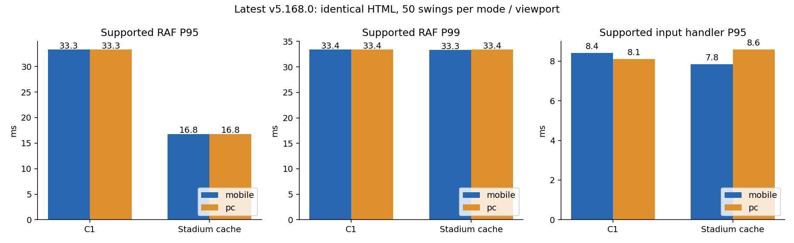
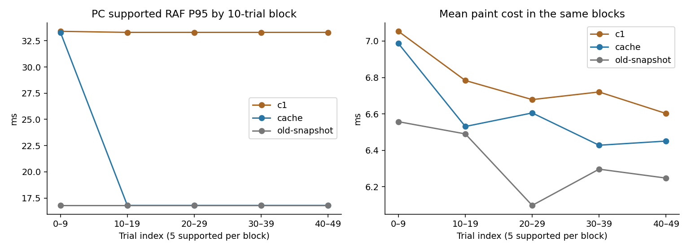

# 구장 캐시 마지막 검증 — v5.168.0

**병합·GitHub Pages 배포 안 함. 기본 C1과 캐시 OFF 유지. C2 미채택. 실제 iPhone Safari 미검증.**

결론: 두 선택지 중 구장 캐시를 배포 후보로 추천한다. 최신 코드의 같은 HTML 위에서 supported P95 개선이 재현됐고 RGB·수명 관리 문제를 최소 수정했다. 초기 구간과 드문 긴 프레임, 실기기 검증은 남아 있어 출시/배포 승인으로 해석하면 안 된다.

## 통제 조건

- 시작 시 최신 claude/next는 `35e9e5b` / v5.168.0이다. 최신 FA·기타 Claude 변경을 보존한 별도 브랜치에서 작업했다. 측정 중 기준을 바꾸지 않았다.
- C1 OFF/캐시 ON 모두 정확히 같은 최신 index.html을 사용한다. 원본 HTML SHA256이 동일함을 assert하고 manifest.json에 기록했다. 바꾼 것은 타석 DOM의 검수 플래그뿐이다.
- 모바일390×844·PC1280×720 × 각 모드50회, 모드·환경당 supported25/fallback25. 같은 시드·타자·투수·직구·코스·입력 목표 시각, 기존과 같은 2회 warmup·70ms 준비·실시간 RAF 측정이다. 실제 전달 지터는 별도 기록한다.
- 판정 결과 함수를 stub하지 않았다. 녹화·RGB 실험·GC 검사는 성능 측정과 따로 실행했다. 이 수치는 Linux Chromium viewport이며 iPhone 하드웨어가 아니다.

## 최신 성능

| 환경/코스 | 모드 | 평균 간격ms / 관측FPS¹ | RAF P95 / P99 / 최대ms | >33.3 / >50ms (프레임 수) | 입력처리 P95 / P99ms | 입력전달 P95ms |
|---|---|---|---|---|---|---|
| mobile/supported | c1 · 25회 | 17.85 / 56.0 | 33.30 / 33.40 / 50.10 | 196 / 1 (총 3808) | 8.40 / 8.48 | 14.74 |
| mobile/supported | cache · 25회 | 16.97 / 58.9 | 16.80 / 33.30 / 50.00 | 43 / 0 (총 3983) | 7.84 / 12.38 | 9.04 |
| mobile/fallback | c1 · 25회 | 17.38 / 57.5 | 16.80 / 33.40 / 66.70 | 110 / 2 (총 3920) | 4.44 / 5.72 | 33.00 |
| mobile/fallback | cache · 25회 | 16.79 / 59.5 | 16.80 / 16.80 / 49.90 | 19 / 0 (총 4028) | 4.12 / 4.58 | 23.46 |
| pc/supported | c1 · 25회 | 18.84 / 53.1 | 33.30 / 33.40 / 50.00 | 335 / 0 (총 3597) | 8.10 / 8.94 | 26.80 |
| pc/supported | cache · 25회 | 17.41 / 57.4 | 16.80 / 33.40 / 66.70 | 122 / 2 (총 3888) | 8.58 / 8.75 | 20.86 |
| pc/fallback | c1 · 25회 | 17.59 / 56.9 | 33.20 / 33.40 / 100.10 | 150 / 1 (총 3858) | 4.18 / 4.28 | 31.88 |
| pc/fallback | cache · 25회 | 16.97 / 58.9 | 16.80 / 33.30 / 50.00 | 49 / 0 (총 3992) | 3.96 / 4.25 | 21.08 |

¹ 1000/평균 RAF 간격. 입력처리는 실제 게임 컨트롤러 act()의 동기 비용이고, 입력전달은 목표 시각 대비 브라우저가 자동화 입력을 전달한 지연이다. 물리적 터치→화면 지연을 측정한 값이 아니다. 33.3ms 임계값에 33.4ms 양자화가 포함된다. fallback 코스에서도 입력 전 READY에는 승인 actor가 사용될 수 있다.



### PC의 이전33.3ms 판정

동일 최신 코드로50회 재측정했을 때 캐시 supported 전체 P95는16.8ms다. 단, 첫10회 블록(지원5회)의 P95는33.3ms였고 다음4개 블록은16.8ms였다. 따라서 초기 구간을 포함한5회 소표본에서33.3ms가 나온다는 현상은 재현되며, 지속적으로 모든 구간이33ms인 구조적 실패와 구분해야 한다. 초기 블록의 평균 paint 비용도 뒤 블록보다 높았다.

기존 live-target snapshot 경로를 되살린 진단용 PC50회도 별도로 수행했다. 그 P95 역시16.8ms여서 스냅샷 제거가 PC 성능 회복의 단독 원인이라고 주장하지 않는다. 스냅샷 제거는 아래 RGB 문제의 원인을 분리한 수정이다. 버전·소표본·초기 비용·실행간 변동이 섞인 예전 수치에서 JIT와 그래픽 스케줄링의 각각의 비중까지는 확정하지 못했다.



### 남은 긴 프레임과 발생 구간

| 환경 | 구간 | C1 RAF P95/P99ms | 캐시 RAF P95/P99ms |
|---|---|---|---|
| mobile | preInput | 16.80/33.26 | 16.70/16.80 |
| mobile | input | 33.40/49.97 | 16.80/25.66 |
| mobile | contact | 33.40/45.61 | 16.80/33.40 |
| mobile | follow | 33.40/33.40 | 16.80/33.30 |
| mobile | hold | 16.80/16.80 | 16.70/16.80 |
| mobile | field | 16.74/16.80 | 16.70/16.80 |
| pc | preInput | 16.80/33.30 | 16.80/16.80 |
| pc | input | 33.40/45.61 | 16.80/33.36 |
| pc | contact | 33.40/33.40 | 33.30/33.40 |
| pc | follow | 33.40/33.40 | 33.40/33.40 |
| pc | hold | 16.80/33.30 | 16.70/16.80 |
| pc | field | 16.80/16.80 | 16.74/16.80 |

preInput=-300..0ms, input=0..100, contact=80..180, follow=180..730, hold=730..1100는 실제 입력 기준이고 field=-50..200은 필드 진입 기준이다. 구간은 일부 겹치며 프레임 간격의 끝 시각으로 분류한다. raw longframes.json에 각 긴 프레임의 입력/필드 상대 시각·paint 합계·LongTask 동반 여부를 남겼다. JS paint 비용만으로 설명되지 않는 간격을 특정 함수/GC/GPU 탓으로 단정하지 않는다.

## RGB10개 사례의 원인 분리

기존 차이10개는 가로844×390/PC1280×720 각각의5개 구장·날씨, 모두 READY(source0)의 첫 비교였다. 대상은 잠실/맑음, 고척/맑음, 광주/비, 보스턴/흐림, 뉴욕/맑음이다. 같은 조건의 CONTACT·FINISH는 기존에도 일치했다. 기존10개는 native RGBA에서 최대31/255 차이가 있었으며 알파 차이는0이었다.

| 실험 | 결과·해석 |
|---|---|
| 캐시 OFF→OFF 반복 | 차이0. 원래 포즈가 저절로 바뀌는 현상 아님. |
| 상태복원만 / 행렬 round-trip만 | 차이0. Canvas 상태/행렬 왕복 자체로 동일 차이 재현 안 됨. |
| 기존 캐시 OFF→cold / cold→warm | 가로/PC에서 RGB433채널·최대9 차이 재현. 이후 warm 반복과 OFF→두 번째 warm은 일치. 캐시 key miss는 첫 생성1회뿐. |
| main Canvas willReadFrequently:true 강제 | 위 차이가 남음. 단순 GPU 활성화 여부만으로 설명할 수 없음. |
| 생성 시 live Canvas 복사만 제거 | 모든 대조 반복에서 차이0. 현재 target을 source로 다시 읽는 snapshot 초기화 경로에 차이가 종속됨을 확인. |

기존 `q.drawImage(cv,0,0)`는 게임의 활성 Canvas를 새 구장 Canvas의 underlay로 복사했다. 해당 단계만 원래 mvPaint가 그리는 빈 바닥/세로 화면 두 배경색으로 재구성했다. 기존 언어·변환 명령 순서는 보존했다. 따라서 cache key 누락을 숨기거나 원본 팔·유니폼·픽셀 색을 보정한 것이 아니다. 현재 target을 source로 되읽는 경로를 없앴다. 브라우저 내부 surface snapshot/copy-on-write의 어느 하위 구현이 RGB 차이를 만드는지까지는 단정하지 않는다.

이 수정은 매 프레임 readback이나 색상 강제 보정, 해상도 축소를 추가하지 않는다. RGB에 대한 수치는 rgb-factorial.json / -cpu.json / -no-snapshot.json / -fixed.json, 각 mainContext 속성에 보관했다.

- 수정본 전체45개 native Canvas 비교: 45/45 완전 일치, 최대 채널 차이 0.
- 기존 snapshot cold, 문제10조건의 compositor screenshot: 10/10 완전 일치, 최대 차이 0.
- 기존 snapshot warm, 문제10조건의 compositor screenshot: 10/10 완전 일치, 최대 차이 0.
- 수정본 cold, 문제10조건의 compositor screenshot: 10/10 완전 일치, 최대 차이 0.
- 수정본 warm, 문제10조건의 compositor screenshot: 10/10 완전 일치, 최대 차이 0.

Compositor 비교는 직접 Canvas getImageData를 호출하지 않고 같은 고정 READY·idleT·정지 CSS에서 화면 크기의 PNG를 읽었다. 기존 native readback 차이를 곧바로 사용자에게 보이는 결함이라고 단정하지 않았다. 수정 후 native와 실제 표시 비교를 각각 보존한다.

## 캐시 메모리·화면 이탈

| 환경 | 측정 중 hit/miss | 적중률² | 회말 최대 RGBA MiB | 준비 포함 build P95/maxms | 측정 타석 중 build P95ms |
|---|---|---:|---:|---|---|
| mobile | 4150/0 | 100.00% | 4.12 | 4.00/5.10 | 생성 없음 |
| pc | 4027/13 | 99.68% | 4.45 | 6.20/8.20 | 7.60 |

² eligible hit/(hit+miss), bypass 제외. 최초 준비 생성은 분모와 별도로 build history에 포함했다. 원시 픽셀 예산12MiB는 브라우저 내부 GPU pool/RSS 전체를 뜻하지 않는다.

새로 추가한 수명 관리는 하나의 MutationObserver가 childList만 관찰해 화면이 분리된 직후 캐시를 제거한다. 마지막 항목이 사라지면 observer도 끊는다. detached 화면의 늦은 paint 호출은 캐시를 재생성하지 않는다.

실제 view 교체 5회: 추가 paint 없이 entries0/bytes0, backing canvas0×0, observer 해제, stale paint 이후에도0. 강제 GC 후 cache entry WeakRef 수거 5/5. 생존 DOM/다른 게임 객체의 전체 메모리까지0이라고 주장하지 않는다.

## 기록·판정·원본 보존

- 검사 12/12 통과. 원본5개 바이트/SHA256, world351표본 최대오차0, actor Canvas44표본 변경채널0.
- 최신35e9e5b 대비 LiveGame, 공 물리/타격 판정, 기록, save/load, 리그/성장 함수 대조. 캐시를 켠 실제 타석 기록·일회 결과 소비·save/load와3×3코스·좌타 기존 경로·3viewport 경계 검사 포함.
- 런타임Factory 및 C1 adapter 전체 소스도 검증 전과 바이트 단위로 같다(clock-unchanged.json). C1 시간 매핑과100ms 판정은 그대로다. 포즈·물리·주루·수비를 수정하지 않았고 C2를 채택하지 않았다.

| 구성 | 결과 집계 | guard-not-ready |
|---|---|---:|
| c1/mobile | {'HR': 26, 'foul': 12, 'whiff': 12} | 0 |
| cache/mobile | {'HR': 26, 'foul': 12, 'whiff': 12} | 0 |
| c1/pc | {'HR': 26, 'foul': 12, 'whiff': 12} | 0 |
| cache/pc | {'HR': 26, 'foul': 12, 'whiff': 12} | 0 |

기본 공정비교 fixture의 fair contact는 HR 조건이다. 일반 안타는 별도 실제1타석/save 검사와 wind0·커서+.08의 영상 fixture로 확인하며, 영상 metadata에 실제 결과를 기록했다.

## 실제 게임 영상

동일 최신 코드, C1 그대로,390×844 정상속도 및 실시간 RAF HUD.25fps 인코딩은 성능 판단 근거가 아니며 녹화 부담은 주 측정에서 제외했다.

- [C1 supported](video/before-supported.mp4) / [캐시 supported](video/after-supported.mp4)
- [C1 fallback](video/before-fallback.mp4) / [캐시 fallback](video/after-fallback.mp4)

## 최종 선택과 남은 위험

구장 캐시를 배포 후보로 선택할 것을 추천한다. 계속33ms에 머물던 C1보다 최신 통제 비교의 반복 프레임 안정성이 낫고, native RGB 문제와 화면 이탈 시 참조 유지 문제를 최소 범위에서 고쳤다.

후보와 배포 승인은 별개다. 초기 지원5회 블록의33.3ms, P99와 드문50ms 이상 간격, 한 타자·구종 중심의 측정 범위, 실제 iPhone Safari 및 기기 메모리 미검증을 남은 위험으로 기록한다. 캐시 기본값은 OFF다. 승인 전 claude/next 병합이나 GitHub Pages 배포는 하지 않는다.

추가 GPU/Worker/포즈 재제작은 이번 단계에서 하지 않았다. 다음 주루·수비는 이 근거리 타격용 소프트웨어 깊이 렌더러를 선수 수만큼 복제하지 않고, 기존 경량 field renderer·공유 텍스처·동시 선수 전체 프레임 예산을 먼저 설계하는 순서를 권한다. 해당 구현은 시작하지 않았다.

## 재현

```sh
MODE=before COUNT=50 SIZE=pc TAG=c1 node gpt-review/stadium-final/measure.cjs
MODE=after COUNT=50 SIZE=pc TAG=cache node gpt-review/stadium-final/measure.cjs
MODE=after COUNT=50 SIZE=pc TAG=old-snapshot OLD_SNAPSHOT=1 node gpt-review/stadium-final/measure.cjs
node gpt-review/stadium-final/verify.cjs
SOURCE=working node gpt-review/stadium-final/rgb.cjs
```
